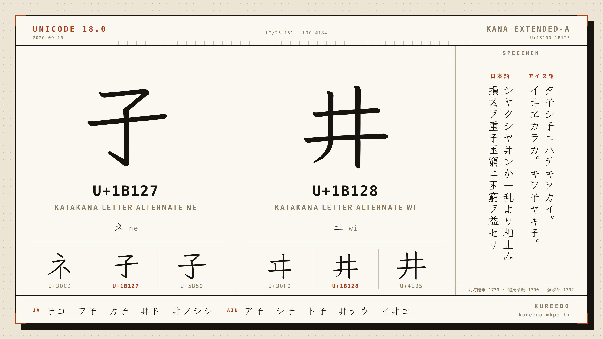
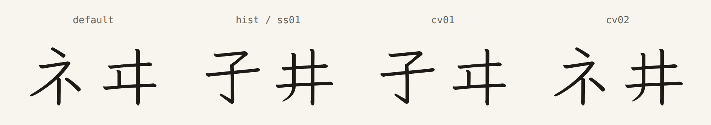
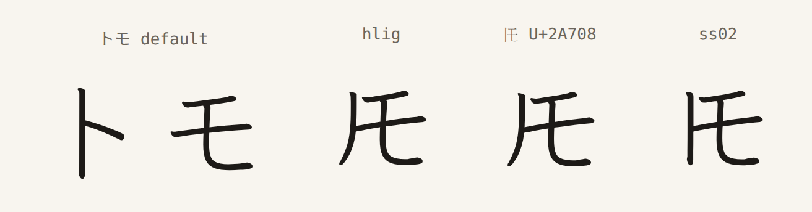
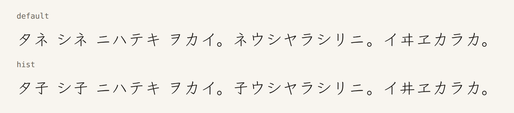
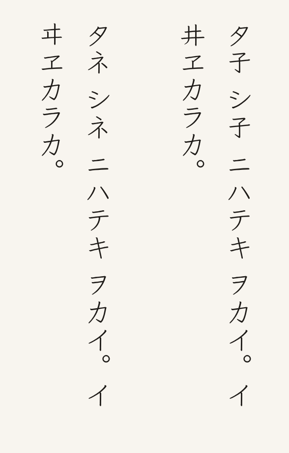
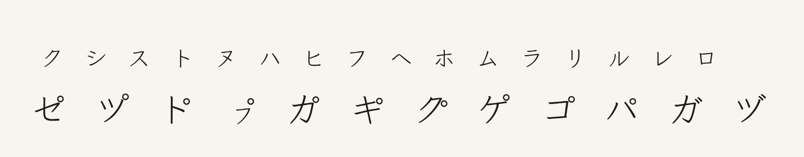
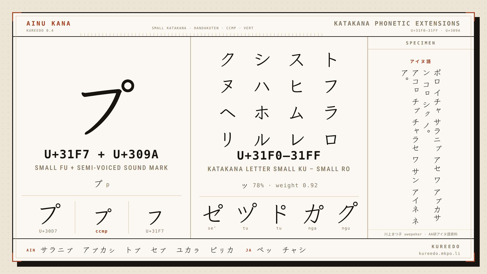
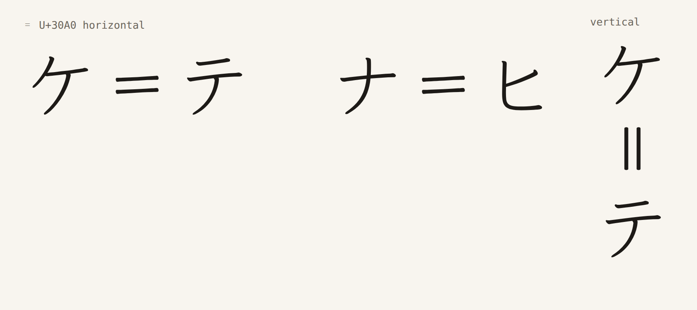
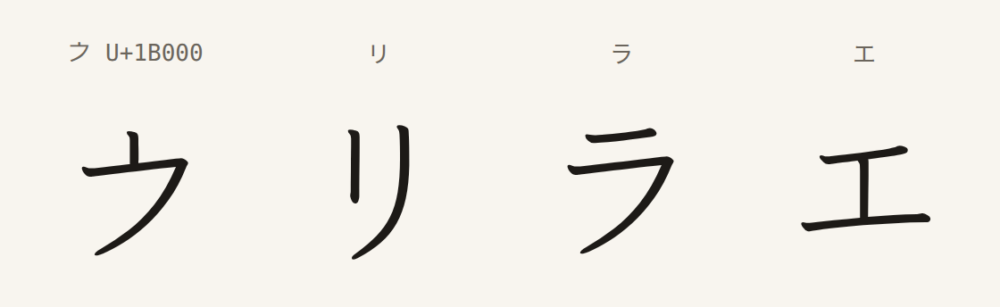

# Kureedo（クレード）

[](https://github.com/mkpoli/kureedo/releases/latest/download/KureedoFull-Regular.zip)
[](https://github.com/mkpoli/kureedo/releases/latest/download/KureedoKana-Regular.zip)
[](OFL.txt)
[](https://www.unicode.org/charts/PDF/Unicode-18.0/U180-1B100.pdf)
[](https://www.jsdelivr.com/package/gh/mkpoli/kureedo)
[](https://kureedo.mkpo.li)

Kureedo is a Klee One derivative for kana that ordinary Japanese fonts leave out. Its historical forms follow Edo-period Japanese print: among them a ネ written like 子 and a ヰ written like 井. Unicode 18.0 encodes them as 𛄧 U+1B127 KATAKANA LETTER ALTERNATE NE and 𛄨 U+1B128 KATAKANA LETTER ALTERNATE WI, and the font covers those code points; the same glyphs are also alternates of ネ and ヰ selected by `hist`, `cv01` and `cv02`, so text encoded with the ordinary letters can show them. It also adds the small katakana ㇰ–ㇿ (U+31F0–31FF), the semi-voiced セ゚ ツ゚ ト゚ ㇷ゚ and the nasal カ゚–コ゚ that Ainu writes and Klee One lacks.

Specimen, type tester and webfont CDN: https://kureedo.mkpo.li





The same woodblock editions set トモ as one letter, 𪜈 U+2A708. The font covers that code point, and the `hlig` feature forms the ligature from トモ. It also covers 𛀀 U+1B000, the archaic katakana e, the double hyphen ゠ U+30A0, the kana repeat marks 〱 U+3031 and 〲 U+3032, and the digraph ヿ U+30FF, which `hlig` also forms from コト.



Related typeface: [GenZui Serif / 源萃明朝](https://genzui.mkpo.li/), a Noto Serif JP derivative with hentaigana and historical kana.

## Editions

One build produces three editions, each as TTF for installation and WOFF2 for the web:

| Font | File stem | Use |
|---|---|---|
| Kureedo Full | `KureedoFull-Regular` | Standalone font for running text. Japanese base, Kureedo additions, and every public Unicode code point Klee One lacks, imported from LXGW WenKai Light 1.530: 46,923 encoded characters, enough for Chinese, Hangul and other scripts to set alongside Japanese without a fallback. Shared code points keep the Japanese base's glyphs; imported ideographs are eroded to the weight Klee's density model predicts ([weight notes](docs/weight.md)), and 贝 is rebuilt from Klee's 貝 and 人 ([notes](docs/bei.md)), 鱼 from 魚 and 一 ([notes](docs/yu.md)). |
| Kureedo Kana | `KureedoKana-Regular` | Available hiragana, katakana, halfwidth kana, kana punctuation and historical forms from the Japanese base. Pair with another font for kanji and Latin. |
| Kureedo Additions | `KureedoAdditions-Regular` | The 26 code points Kureedo supplies beyond Klee One, for fallback at those code points. |

Published packages are on the [releases page](https://github.com/mkpoli/kureedo/releases); 0.5.0 carries the three editions, earlier releases the Kureedo and Kureedo Kata pair.

## Scope

Kureedo is a kana font first. The imported outlines in Full stay WenKai's drawings apart from the weight pass and the two rebuilt characters, so Full closes coverage gaps rather than supplying Klee-style ideographs. The kana side stays narrow: hentaigana in Kana Supplement, unencoded regional kana, the Okinawan private-use letters and IVD variation sequences are absent. [Coverage and edition notes](docs/coverage.md) measure the gaps and delimit each edition.

## Using the fonts

For a kana overlay, self-host the WOFF2:

```css
@font-face {
  font-family: "Kureedo Kana";
  src: url("KureedoKana-Regular.woff2") format("woff2");
  font-display: swap;
}
.edition { font-family: "Kureedo Kana", "Klee One", serif; font-feature-settings: "hist"; }
```

On the desktop, install `KureedoFull-Regular.ttf` and pick Kureedo Full. Historical forms come from the OpenType feature panel (Word: Font dialog, Advanced; LibreOffice: append `:hist` to the font name) or by typing U+1B127 and U+1B128 directly. ㇷ (U+31F7) followed by the combining handakuten U+309A gives ㇷ゚; セ゚ ツ゚ ト゚ and カ゚–コ゚ work the same way.

Kureedo Additions is a fallback for the 26 added code points. Select Full or Kana for features applied to ordinary kana, including `hist` for ネ/ヰ and `hlig` for トモ/コト.

The published CDN still serves the 0.4.3 Kureedo Kata stylesheet, since the site has not deployed 0.5.0. Its `/kureedo.css` alias follows the deployed release and `/v0.4.3/kureedo.css` and the WOFF2 beside it are pinned, with CORS and a one-year cache. Use the 0.5.0 zips from the releases page meanwhile.

### Historical forms

Text encoded with the Kana Extended-A letters needs no feature. For text encoded with ordinary ネ and ヰ — which keeps search, sorting and copying working in software that has never heard of U+1B127 — the features below select the same glyphs.

| Feature | Effect |
|---|---|
| `hist` | All historical forms. |
| `ss01` | Edo-period printed forms. In this release the same set as `hist`. |
| `cv01` | ネ only. |
| `cv02` | ヰ only. |
| `hlig` | トモ → 𪜈. Off by default, since not every トモ in a text is the ligature. |
| `ss02` | Straight left stroke for 𪜈; the default curves like 丿. Works with the encoded letter and with `hlig`. |





Klee One's own `hkna`/`vkna` alternates of ネ and ヰ also become the historical forms when a historical feature is on. In the full font, `hwid` and `ruby` keep Klee One's shapes and `aalt` lists the historical forms; Kureedo Kana carries none of those three features. Word processors list the character variants under their feature names; the fonts carry English and Japanese names. Kureedo Additions supports direct character input; use Kana or Full for features applied to ordinary kana.

## Coverage of Kureedo Kana

The Kana subset contains 311 encoded characters available in the Japanese base: hiragana, katakana, halfwidth kana, kana punctuation and marks, and Kureedo's historical forms. Its requested ranges cover U+0020, U+3000–30FF, U+31F0–31FF, U+FF61–FF9F, U+1AFF0–1B16F and U+2A708. Unsupported code points remain absent. `fonttools ttx -t cmap` lists the exact set. Glyphs Klee One does not have and this font adds: 𛄧 𛄨 𪜈 𛀀 ゠ 〱 〲 ヿ; the Ainu small kana ㇰ–ㇿ (U+31F0–31FF), set the way Klee sets its own small kana (78% of the full-size letter, centred on the baseline, stroke weight brought back to 0.92 of the full-size stroke as Klee's own ッ and ァ keep it, shifted up and right in vertical text through `vert`); combining ゛ and ゜ with zero advance; and `ccmp` ligatures that set セ゚ ツ゚ ト゚ ㇷ゚ カ゚ キ゚ ク゚ ケ゚ コ゚ in one cell, horizontally and vertically. The handakuten of ㇷ゚ is scaled with the letter and sits where プ puts its own, at プ's clearance from the stroke; on the full-size bases it starts where Klee places the dakuten on the same letter and keeps that clearance (`scripts/mark_positions.py`, `docs/methods.md`).





## ゠ double hyphen

゠ U+30A0 uses two native Klee hyphen strokes rising 3°. Vertical text uses two straight uprights through `vert` or `vrt2`. The selected pair won seven of eight finalist comparisons; the complete ballot and decision are in `docs/votes/double-hyphen/`.



## 𛀀 archaic katakana e

𛀀 U+1B000 joins an upright head from Klee One’s リ to the lower stroke of ラ. The same outline serves horizontal and vertical text. It won five of six primary finalist comparisons and tied the sixth; the ballot and confirmed design are in `docs/votes/archaic-e/`.



## 〱 〲 kana repeat mark

〱 U+3031 and 〲 U+3032 are Klee One's two-cell 〳 and 〵 joined at their own elbow into one glyph. Its outline is 1,823 units tall, close to GenZui Serif's 1,840, on a one-em horizontal advance, and it takes two cells in vertical text: the vertical advance is 2,000 units, half an em above and below the em box. 〲 adds the dakuten Klee sets beside 〴. The outlines and the settings behind them are in `docs/votes/repeat-mark/`.

## ヿ koto digraph

ヿ U+30FF is the bar, corner and upright of Klee One's 刁 with the upright made perpendicular to the baseline and ended with the plain foot of 川's right stroke. The bar rises 5.29°, as the top bar of Klee's コ does. `hlig` forms it from コト. The settings and the written forms it was compared with are in `docs/votes/koto/`.

## Sources of the forms

**ネ from 子.** The Edo-period printed katakana ネ keeps the shape of its source character 子: an angular upper turn, a sloping crossbar, an upright stem and a short curved hook. Reference specimen: 上原熊次郎『蝦夷方言藻汐草』(1792), volume 2, [image 81](https://dglb01.ninjal.ac.jp/iiif/ezomosio/002/tiff/ezmg002-081.tiff/full/1495,/0/default.jpg) (国立国語研究所, CC BY 4.0), with the [292 ネ samples](https://codh.rois.ac.jp/char-shape/unicode/U%2B30CD/) in CODH's kuzushiji index (日本古典籍くずし字データセット, 国文研ほか所蔵／CODH加工, doi:10.20676/00000340, CC BY-SA 4.0) as the wider comparison.

**ヰ from 井.** The printed ヰ of the same editions keeps the full 井 frame. Eiso Chan, *Proposal on two archaic Katakana letters*, [L2/25-151](https://www.unicode.org/L2/L2025/25151-katakana-ne-wi.pdf) (2025-05-23), page 1 and section 3, collects historical specimens of both letters; the UTC accepted it at meeting 184 and Unicode 18.0 encodes the two letters in [Kana Extended-A](https://www.unicode.org/charts/PDF/Unicode-18.0/U180-1B100.pdf) under the heading Historic Katakana. They are separate letters from 子 U+5B50 and 井 U+4E95, and have no decomposition to ネ or ヰ.

**𪜈 from ト and モ.** The default has a curved 丿-like left stroke joined to モ. Its upper and middle bars rise 9° and 8° respectively; their contours retain Klee One’s pen terminals. `ss02` uses a straight left stroke with the same モ. The proportions follow the Unicode code chart glyph for [U+2A708](https://www.unicode.org/charts/PDF/U2A700.pdf) (source JK-65004) and the printed instances in 池田霧渓『種痘弁義』(1858), [image 6](https://dl.ndl.go.jp/api/iiif/2539156/R0000006/full/full/0/default.jpg) (国立国会図書館, [doi:10.11501/2539156](https://doi.org/10.11501/2539156), public domain), located through the みんなで翻刻 transcription ([honkoku-data v3](https://github.com/yuta1984/honkoku-data), CC BY-SA 4.0). The print sets the left stroke no taller than the モ and joins the bars to it; the code chart leaves them apart. The selected font outline joins the middle bar to the left stroke.

The 0.2 ヰ outline keeps Klee's uprights and stroke ends and sets the bars 50 units closer, the upper 30 and the lower 60 units longer; it beat the 0.1 outline and the other finalists in blind comparison. `docs/methods.md` describes how each form was chosen, including the small kana and the mark positions, and `docs/votes/` holds the comparison records.

## Building

```sh
python -m venv .venv
.venv/bin/pip install -r requirements.txt
.venv/bin/python scripts/build.py
.venv/bin/python scripts/check.py
.venv/bin/python scripts/check_editions.py
.venv/bin/python scripts/package.py
```

The build downloads Klee One Regular from the pinned commit of [fontworks-fonts/Klee](https://github.com/fontworks-fonts/Klee) (`8b05327`) and verifies its SHA-256 before use. The Full edition also downloads the checksum-pinned LXGW WenKai 1.530 Light release. Its outlines and layout dependencies supply only missing public code points; donor private-use entries and variation sequences are excluded. Imported ideographs are eroded to the stroke width Klee's density model predicts; advances and vertical origins stay, and shared glyphs are untouched ([weight notes](docs/weight.md)). `sources/glyphs/` holds the historical outlines as SVG in a 1000-unit em, y down, em top at y=880. `check.py` shapes the built fonts with HarfBuzz: default glyphs, every feature in both writing directions, mark composition, small-kana vertical origins, and byte identity of every Klee One glyph in the full font. `specimen/index.html` shows the result. `site/` holds the specimen site and CDN at kureedo.mkpo.li; `site/README.md` describes how a release is published there.

## Sponsor

I make Kureedo alone, out of love for the kana of Edo-period print. I don't have a job, and my small TA pay doesn't cover rent and food. Even one dollar on [Ko-fi](https://ko-fi.com/mkpoli) helps me eat today. Companies interested in sponsoring can write to mkpoli@mkpo.li.

[](https://ko-fi.com/mkpoli)

## Licence

The fonts are licensed under the SIL Open Font License 1.1 (`OFL.txt`). The Full edition includes LXGW WenKai contributions, Copyright 2021–2026 LXGW; its upstream notice and reserved font names are in `sources/wenkai/OFL.txt` and in the Full font metadata. Distributions of Full must include that notice alongside `OFL.txt`. Klee One is Copyright 2020 The Klee Project Authors; Klee is a trademark of Fontworks Inc., and Kureedo is an independent derivative with no connection to Fontworks. The historical outlines and the scripts in this repository are Copyright 2026 The Kureedo Project Authors; the scripts are released under the MIT License (`LICENSE-scripts.txt`).

## Author

まくぽり / mkpoli — https://mkpo.li
