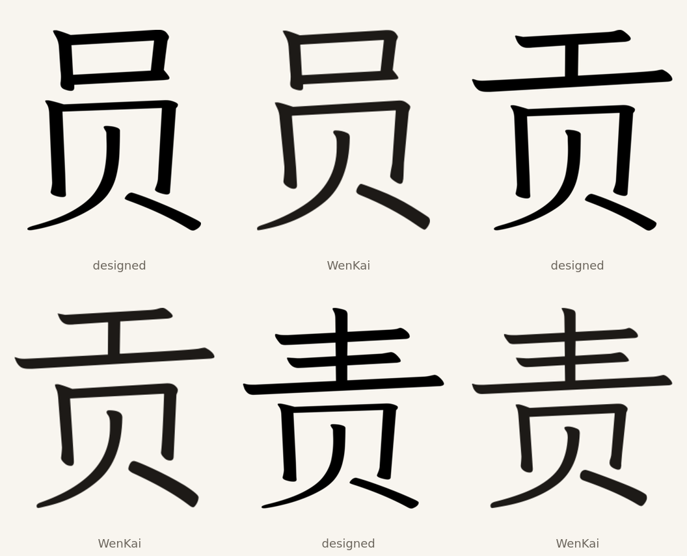

# 员, 贡 and 责 with the designed 贝

员 U+5458, 贡 U+8D21 and 责 U+8D23 are common characters whose top and bottom
贝 are separated by a clean horizontal gap. Each keeps its WenKai top and takes
the designed 贝 U+8D1D as its bottom.

The split comes from the ink projection: the gap runs at 0.329 of 员's height,
0.339 of 贡's and 0.453 of 责's. The designed 贝 is scaled to the donor 贝 box,
unioned with the top, and dilated to Klee's weight model.

| Character | Dilation | Measured / target | Residual |
| --- | ---: | ---: | ---: |
| 员 | 1.98 | 44.46 / 43.96 | 1.011 |
| 贡 | 2.58 | 44.48 / 43.51 | 1.022 |
| 责 | 2.30 | 42.73 / 42.44 | 1.007 |

The top components, advances and vertical origins stay as WenKai normalized
them. The three glyphs replace U+5458, U+8D21 and U+8D23 in Full only through
`DESIGNED_IMPORTS`. No glyph composites them, so the Full glyph count does not
change.

The other 贝 compounds without a clean gap (负, 质, 费, 贺, 资) keep WenKai's
bottom 贝; they need a cut that follows the component boundary.

## Checks

`check_editions.py` compares each designed import with its SVG and checks its
weight against the model. The preserved U+2EE5 and U+2EC9 radicals from the earlier
designs remain covered.

## Sources

Klee One Regular and LXGW WenKai Light 1.530 as pinned in this repository.
BabelStone IDS, Andrew West, file date 2025-06-27, SHA-256
`cc2a0a97e6a51ed6ebe59870ef2af66e83f3c3c27387d79b4441bb2d791d78b1`.
