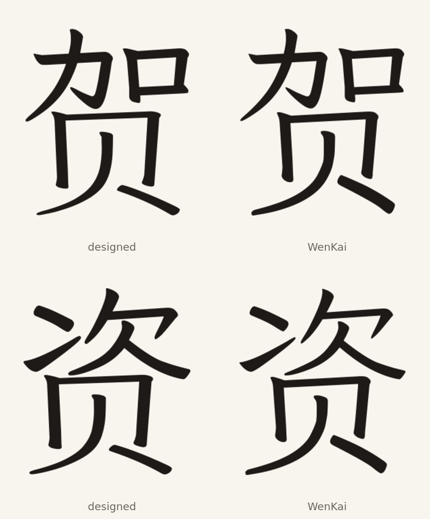

# 贺 and 资 with the designed 贝

贺 U+8D3A and 资 U+8D44 have no clean horizontal gap above their 贝; the top
and the 贝 meet. Their top and bottom are separate contour groups, so the whole
bottom 贝 can be replaced without cutting a stroke.

The top path keeps its contours, including the 口 counter of 贺. The bottom
contours (the 贝 frame and both legs) are replaced with the designed 贝 U+8D1D,
scaled to the donor 贝 box and unioned with the top. The result is dilated to
Klee's weight model.

| Character | Dilation | Measured / target | Residual |
| --- | ---: | ---: | ---: |
| 贺 | 2.10 | 43.08 / 42.65 | 1.010 |
| 资 | 4.00 | 43.32 / 42.49 | 1.020 |

The top components, advances and vertical origins stay as WenKai normalized
them. The glyphs replace U+8D3A and U+8D44 in Full only through
`DESIGNED_IMPORTS`. No glyph composites them, so the Full glyph count does not
change.

## Checks

`check_editions.py` compares each designed import with its SVG and checks its
weight against the model. The preserved U+2EE5 and U+2EC9 radicals remain
covered.

## Sources

Klee One Regular and LXGW WenKai Light 1.530 as pinned in this repository.
BabelStone IDS, Andrew West, file date 2025-06-27, SHA-256
`cc2a0a97e6a51ed6ebe59870ef2af66e83f3c3c27387d79b4441bb2d791d78b1`.
