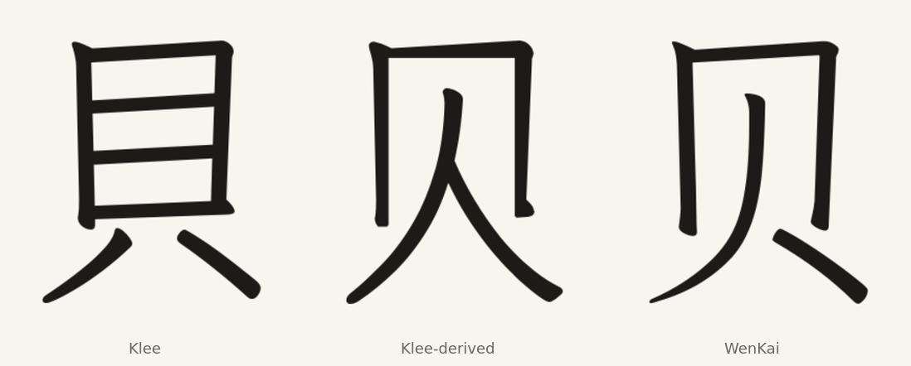

# 贝 from Klee's 貝 and 人

贝 U+8D1D is the simplified form of 貝. BabelStone IDS uses it as a leaf in 76
imported ideographs. Klee draws 貝 with a closed 目 frame and four short legs;
贝 needs an open 冂 frame and a long 人 inside it.

The frame is Klee 貝's outer contour with the 目 interior and bottom bar cut
away, leaving a 冂. The legs are Klee 人 scaled into the 贝 leg box. The two are
unioned and dilated 6.5 units to Klee's weight model: measured stroke width 34.0 → 46.5, close to Klee 貝's 45.7 and WenKai
贝's 44.9. Unlike 鱼, the scaled 人 lost
weight, so dilation, not erosion, brings it back.

The glyph replaces WenKai's U+8D1D outline in Full only through
`DESIGNED_IMPORTS`. The retained radical U+2EC9 is a composite over 贝; its donor
outline is preserved under `u8D1D.donor` and the composite retargeted there, so
only U+8D1D's resolved outline changes. The Full font gains one more glyph name;
the encoded repertoire is unchanged.

The frame's inner corners are rectangular rather than Klee's drawn inner
corners, and the 人 sits a little wider than WenKai's. It needs a text-size
review before any further use.

## Checks

`check_editions.py` compares the built glyph with the SVG, checks its weight,
and verifies every preserved donor component and its resolved composite. The
same loop covers the U+2EE5 fish radical from the earlier design.

## Sources

Klee One Regular and LXGW WenKai Light 1.530 as pinned in this repository.
BabelStone IDS, Andrew West, file date 2025-06-27, SHA-256
`cc2a0a97e6a51ed6ebe59870ef2af66e83f3c3c27387d79b4441bb2d791d78b1`.
