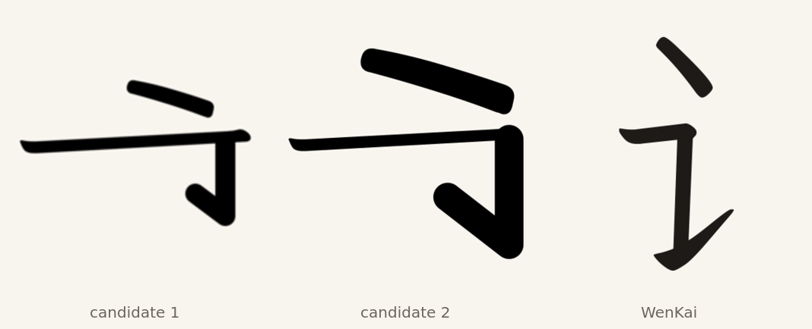

# A Klee-derived 讠 radical

讠 U+8BA0 is the most common missing left radical after 钅: BabelStone IDS
leaves it in 155 imported ideographs. Two candidates were built from Klee 言
U+8A00 and compared with WenKai's normalized 讠.

Both candidates take the dot and one top horizontal from Klee's 言, then add a
horizontal-turn-rising stroke drawn as a round-capped line. Candidate 1 uses a
longer bar and a short hook. Candidate 2 shortens the bar to WenKai's width and
lengthens the hook.

Candidate 2 matches WenKai's width and weight, but its hook is a uniform stub:
Klee's rising strokes taper toward the tip, and WenKai's 讠 keeps a long, thin
hook. The dot is also flatter than Klee's. Neither candidate is better than the
normalized WenKai glyph, so no glyph is added to the font.

The exercise points to a limit of building radicals by cutting and stroking
Klee parts. The dot and horizontals transfer, but the turned hook needs a drawn
taper. The missing radicals WenKai supplies are already derived from Klee
SemiBold; the weight pass brings them to Klee's width. The remaining gap in
common simplified characters is structural, not the radical face.

Next candidates for a design pass, in order of visible effect: 马, 鸟, 鱼, 龙,
书, 乐, 车. These are cursive-derived forms where WenKai departs from Klee's
construction, and a candidate needs comparison at text size before it ships.

Sources: Klee One Regular and LXGW WenKai Light 1.530 as pinned in this
repository; BabelStone IDS, Andrew West, file date 2025-06-27, SHA-256
`cc2a0a97e6a51ed6ebe59870ef2af66e83f3c3c27387d79b4441bb2d791d78b1`.
