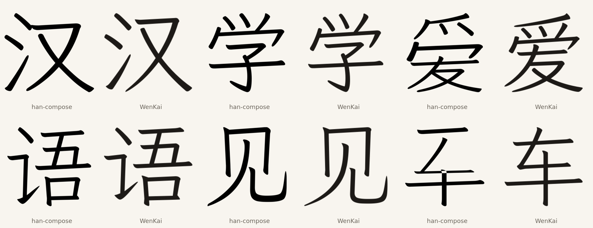

# Recomposition of simplified ideographs

The weight pass matches the imported outlines to Klee's stroke width. It cannot
change how the added glyphs are built: LXGW assembled many of them by cutting
and joining strokes, so component proportions and joins still differ from
Klee's drawings. Recomposition would redraw a simplified character from Klee
components, keeping its IDS structure.

This note records what can be recomposed, what the current composer does with
those characters, and the gate a replacement has to pass.

## Candidates

The imported set is the 13,075 BMP ideographs WenKai has and Klee lacks.
BabelStone IDS describes 13,071 of them. A character is a candidate for full
recomposition when every leaf of its IDS exists in Klee's cmap.

| Measure | Count |
| --- | ---: |
| Imported BMP ideographs | 13,075 |
| With an IDS | 13,071 |
| Every leaf in Klee | 8,677 (66.4%) |
| Exactly one missing leaf | 3,908 |
| GB2312 ideographs imported | 2,983 |
| GB2312 with every leaf in Klee | 1,205 (40.4%) |

The GB2312 figure is the practical one: the common set has more radical-only
characters whose components are missing. The leaf test is also conservative.
It uses the cmap, so radicals such as 釒 U+91D2 and 糹 U+7CF9 count as missing
even though Klee draws them inside 金 and 糸; a component cut from those hosts
would raise the candidate count.

The common missing leaves:

| Leaf | Characters |
| --- | ---: |
| 釒 U+91D2 | 422 |
| 钅 U+9485 | 246 |
| 𤣩 U+248E9 | 202 |
| 糹 U+7CF9 | 193 |
| 讠 U+8BA0 | 155 |
| 纟 U+7E9F | 154 |
| 鱼 U+9C7C | 113 |
| 鸟 U+9E1F | 90 |
| 贝 U+8D1D | 76 |
| 马 U+9A6C | 72 |
| 车 U+8F66 | 61 |
| 页 U+9875 | 54 |
| 饣 U+9963 | 52 |

## Segmentation

A replacement has to know where one component ends and the next begins. For
binary ⿰/⿱ characters whose two leaves both exist in Klee, only 45 of 7,872
have a clean ink-free gap along the operator axis; in the rest the strokes
touch or overlap. Axis clipping cuts strokes, and the result needs a real cut
that follows component ownership.

## Composer result

`han-compose` was run with its Kaisho layout model, Klee as the primary font and
WenKai as the fallback for missing leaves. The six characters below compare the
composition with WenKai's own glyph at the same ink height:

The layout is closer than an untrained split, but the parts remain oversized
and the strokes bolder. 见 and 车 are structurally wrong. Nothing here is good
enough to replace a shipped glyph, so this pass adds no font change.

## Gate for a replacement

A recomposed glyph replaces WenKai's only when it meets all of:

1. every leaf comes from Klee, or from a named Klee host cut;
2. its ink box matches the WenKai glyph's within 2%;
3. its stroke width matches Klee's density model within 3%;
4. its ink overlaps WenKai's at 0.80 IoU or better after box alignment;
5. a person compares it with the WenKai glyph at text size before it ships.

The next work is a Klee-trained layout model, or a component library cut from
Klee hosts for the missing radicals, so the composer has correct parts to place.

## Sources

- BabelStone IDS, Andrew West, file date 2025-06-27, SHA-256
  `cc2a0a97e6a51ed6ebe59870ef2af66e83f3c3c27387d79b4441bb2d791d78b1`;
  public-domain facts per its header.
- Klee One Regular and LXGW WenKai Light 1.530 as pinned in this repository.
- `han-compose` layout model `compose-layout-v4-kaisho.npz` from the local
  checkout; its training data is not recorded here.
