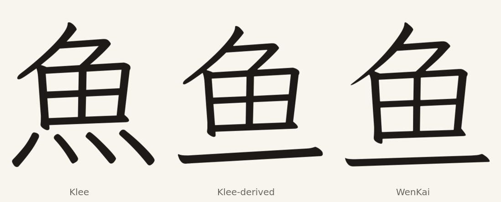

# 鱼 from Klee's 魚 and 一

鱼 U+9C7C is the missing simple form of 魚. BabelStone IDS uses it as a leaf in
113 imported ideographs, and WenKai draws it with a bottom bar where Klee's 魚
has four dots.

The designed glyph takes Klee 魚's upper strokes and 田 unchanged, drops the
four dots, and sets Klee 一 as the bottom bar. The bar takes WenKai's 鱼 width
and sits 25 units above its bar box, narrowing the gap to the 田. The outline is
eroded 2.3 units to Klee's weight model (stroke width 47.8 → 43.0), matching the
imported layer rather than WenKai's raw Light weight.

The upper part and the bar are Klee's own strokes. The glyph keeps a
1,000-unit advance. It is a replacement in Full only: `DESIGNED_IMPORTS` in
`scripts/build.py` overrides the imported outline after the merge. Kana and
Additions do not carry it, and no other edition's repertoire changes. The
retained radical U+2EE5 is a composite over 鱼; its donor outline is kept under
the name `u9C7C.donor` and the composite is retargeted there, so only U+9C7C's
resolved outline changes.

The result is not a repaint of WenKai's glyph: the 田, the top stroke and the
bar keep Klee's terminals. The bar placement still needs a text-size review.

## Checks

`check_editions.py` compares the built glyph with the SVG coordinates, checks
its weight against the model, and exempts it from the donor-outline comparison.
The rest of the imported set keeps the weight pass from the parent branch.

## Sources

Klee One Regular and LXGW WenKai Light 1.530 as pinned in this repository.
BabelStone IDS, Andrew West, file date 2025-06-27, SHA-256
`cc2a0a97e6a51ed6ebe59870ef2af66e83f3c3c27387d79b4441bb2d791d78b1`.
